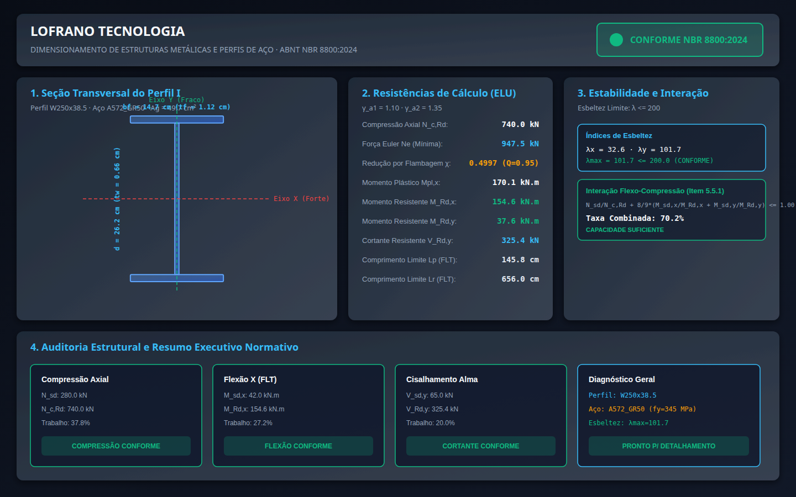

# Dimensionamento de Estruturas Metálicas e Perfis de Aço (ABNT NBR 8800:2024)

[](https://github.com/martinlofranodeoliveira/dimensionamento-estruturas-metalicas-nbr8800/actions/workflows/ci.yml)
[](https://www.python.org/)
[](LICENSE)
[](https://www.abnt.org.br/)
[-purple.svg)](https://docs.python.org/3/library/fractions.html)
[-success.svg)](pyproject.toml)

Biblioteca e ferramenta de linha de comando para **dimensionamento e verificação estrutural analítica de perfis de aço laminados de abas paralelas (série W)** sob tração axial, compressão axial (flambagem de Euler e redução anelástica), flexão simples com flambagem lateral com torção (FLT), força cortante e flexo-compressão combinada, estritamente conforme a **ABNT NBR 8800:2024** (*Projeto de estruturas de aço e de estruturas mistas de aço e concreto de edifícios*).

Desenvolvido segundo o padrão de engenharia **LOFRANO TECNOLOGIA**, com **zero dependências externas** (apenas biblioteca padrão do Python), **aritmética racional exata** (`fractions.Fraction` em 100% dos cálculos físicos e geométricos, eliminando erros de arredondamento de ponto flutuante IEEE-754) e suporte a múltiplos formatos de exportação técnica (relatórios em texto, JSON canônico sem float, CSV sanitizado contra injeção de fórmulas, painéis vetoriais SVG e pacotes determinísticos ZIP com carimbo temporal fixo).

---



---

## 1. Fundamentos Normativos e Formulação Analítica

A biblioteca implementa rigorosamente os critérios dos Estados Limites Últimos (ELU) e de Serviço (ELS) estipulados pela **ABNT NBR 8800:2024**:

### 1.1 Coeficientes de Ponderação de Resistência (Item 5.1.2)
- **$\gamma_{a1} = 1{,}10$**: Combinações normais de ações para escoamento, flambagem e flexão.
- **$\gamma_{a2} = 1{,}35$**: Ruptura na seção líquida sob tração axial e elementos de ligação.

### 1.2 Barras Tracionadas (Item 5.2)
Para barras submetidas à tração axial pura, a força resistente de cálculo $N_{t,Rd}$ é o menor valor entre:
1. **Escoamento da seção bruta**:
   $$N_{t,Rd1} = \frac{A_g \cdot f_y}{\gamma_{a1}}$$
2. **Ruptura da seção líquida efetiva**:
   $$N_{t,Rd2} = \frac{A_e \cdot f_u}{\gamma_{a2}}$$
3. **Limite de Esbeltez**: $\lambda = \frac{K \cdot L}{r_{\min}} \le 300$.

### 1.3 Barras Comprimidas e Flambagem Global (Item 5.3)
Para elementos sujeitos a esforço axial de compressão:
1. **Esbeltez Máxima Normativa**:
   $$\lambda_{\max} = \max\left(\frac{K_x L_x}{r_x}, \frac{K_y L_y}{r_y}\right) \le 200$$
2. **Força Elástica de Flambagem de Euler**:
   $$N_e = \frac{\pi^2 E I}{(K L)^2}$$
3. **Esbeltez Adimensional ($\lambda_0$)**:
   $$\lambda_0 = \sqrt{\frac{Q \cdot A_g \cdot f_y}{N_e}}$$
   *(onde $Q$ é o fator de redução por flambagem local de elementos comprimidos)*.
4. **Fator de Redução da Resistência à Compressão ($\chi$)**:
   - Para $\lambda_0 \le 1{,}50$:
     $$\chi = 0{,}658^{\lambda_0^2}$$
   - Para $\lambda_0 > 1{,}50$:
     $$\chi = \frac{0{,}877}{\lambda_0^2}$$
5. **Força Axial Resistente de Cálculo**:
   $$N_{c,Rd} = \frac{\chi \cdot Q \cdot A_g \cdot f_y}{\gamma_{a1}}$$

### 1.4 Barras Fletidas (Item 5.4)
Para vigas e perfis I com flexão em torno do eixo de maior inércia ($X$):
1. **Momento de Plastificação Total**:
   $$M_{pl,x} = Z_x \cdot f_y$$
2. **Flambagem Lateral com Torção (FLT)** com comprimento destravado $L_b$:
   - Comprimento limite de plastificação:
     $$L_p = 1{,}76 \cdot r_y \cdot \sqrt{\frac{E}{f_y}}$$
   - Se $L_b \le L_p \implies M_{Rd,x} = \frac{M_{pl,x}}{\gamma_{a1}}$ (viga curta, regime plástico).
   - Se $L_p < L_b \le L_r \implies$ FLT inelástica com interpolação linear ponderada pelo fator de momento $C_b$:
     $$M_{c,x} = C_b \left[ M_{pl,x} - (M_{pl,x} - M_r)\left(\frac{L_b - L_p}{L_r - L_p}\right) \right] \le M_{pl,x}$$
3. **Flexão em torno do Eixo Fraco ($Y$)**:
   $$M_{Rd,y} = \min\left( \frac{Z_y \cdot f_y}{\gamma_{a1}}, \frac{1{,}6 \cdot W_y \cdot f_y}{\gamma_{a1}} \right)$$

### 1.5 Força Cortante na Alma (Item 5.4.3)
Para a alma do perfil submetida a esforço cortante $V_{sd}$:
$$A_w = d \cdot t_w$$
A esbeltez da alma $h/t_w$ é comparada ao limite $1{,}10 \sqrt{\frac{k_v E}{f_y}}$ (com $k_v = 5{,}0$):
- Se $h/t_w \le 1{,}10 \sqrt{\frac{k_v E}{f_y}} \implies C_v = 1{,}0$ (escoamento por cisalhamento plástico).
- Força cortante resistente de cálculo:
  $$V_{Rd,y} = \frac{0{,}60 \cdot A_w \cdot f_y \cdot C_v}{\gamma_{a1}}$$

### 1.6 Flexo-Compressão Combinada (Item 5.5.1)
Para barras simultaneamente solicitadas por compressão axial $N_{sd}$ e momentos fletores $M_{sd,x}$ e $M_{sd,y}$:
- Se $\frac{N_{sd}}{N_{c,Rd}} \ge 0{,}20$:
  $$\frac{N_{sd}}{N_{c,Rd}} + \frac{8}{9}\left( \frac{M_{sd,x}}{M_{Rd,x}} + \frac{M_{sd,y}}{M_{Rd,y}} \right) \le 1{,}00$$
- Se $\frac{N_{sd}}{N_{c,Rd}} < 0{,}20$:
  $$\frac{N_{sd}}{2 \cdot N_{c,Rd}} + \left( \frac{M_{sd,x}}{M_{Rd,x}} + \frac{M_{sd,y}}{M_{Rd,y}} \right) \le 1{,}00$$

---

## 2. Instalação

O pacote não requer bibliotecas de terceiros:

```bash
git clone https://github.com/martinlofranodeoliveira/dimensionamento-estruturas-metalicas-nbr8800.git
cd dimensionamento-estruturas-metalicas-nbr8800
python3 -m pip install .
```

Ou diretamente a partir do release wheel (`.whl`):
```bash
pip install dimensionamento_estruturas_metalicas_nbr8800-1.0.0-py3-none-any.whl
```

---

## 3. Uso via Linha de Comando (CLI)

O executável de linha de comando `estruturas-metalicas` disponibiliza subcomandos completos e autoexplicativos:

### 3.1 Consultar Catálogo de Perfis e Aços
```bash
# Listar todos os perfis laminados da série W disponíveis
estruturas-metalicas catalogo --tipo perfis

# Listar aços estruturais cadastrados (ASTM A36, ASTM A572 Grau 50)
estruturas-metalicas catalogo --tipo acos

# Exibir catálogo completo
estruturas-metalicas catalogo --tipo todos
```

### 3.2 Gerar Modelos de Arquivos de Entrada
```bash
# Gerar exemplo de viga-coluna sob flexo-compressão combinada
estruturas-metalicas gerar-exemplo --tipo combinada -o entrada_viga_coluna.json

# Gerar exemplo de pilar comprimido puro
estruturas-metalicas gerar-exemplo --tipo compressao -o pilar_w200.json

# Gerar exemplo de viga sob flexão simples
estruturas-metalicas gerar-exemplo --tipo flexao -o viga_piso.json
```

### 3.3 Verificar Conformidade Normativa Rápida (Exit Code)
```bash
estruturas-metalicas verificar entrada_viga_coluna.json
```
Retorna código de saída `0` se todos os critérios forem atendidos ou `1` em caso de não conformidade ou falha estrutural.

### 3.4 Calcular e Exportar Relatórios Técnicos
```bash
# Memorial de cálculo detalhado em texto puro no terminal
estruturas-metalicas calcular entrada_viga_coluna.json -f texto

# Exportar memorial para arquivo
estruturas-metalicas calcular entrada_viga_coluna.json -f texto -o memorial.txt

# Exportar resultado canônico em JSON (sem floats, frações racionais exatas)
estruturas-metalicas calcular entrada_viga_coluna.json -f json -o resultado.json

# Exportar planilha CSV protegida contra injeção de fórmulas
estruturas-metalicas calcular entrada_viga_coluna.json -f csv -o planilha.csv

# Gerar painel vetorial SVG em alta resolução (1440x900)
estruturas-metalicas calcular entrada_viga_coluna.json -f svg -o painel.svg

# Gerar pacote determinístico ZIP com carimbo temporal imutável
estruturas-metalicas calcular entrada_viga_coluna.json -f zip -o pacote_projeto.zip
```

---

## 4. Uso via Biblioteca Python (API)

```python
from fractions import Fraction
from estruturas_metalicas_nbr8800 import (
    dimensionar_perfil_metalico,
    CondicoesContornoAco,
    SolicitacoesAco,
    exportar_relatorio_texto,
    gerar_painel_svg,
)

# 1. Definir condições de contorno e comprimentos de flambagem
contorno = CondicoesContornoAco(
    kx_lx_cm=Fraction(350, 1),   # Kx*Lx = 350.0 cm
    ky_ly_cm=Fraction(350, 1),   # Ky*Ly = 350.0 cm
    lb_cm=Fraction(175, 1),      # Lb = 175.0 cm (comprimento destravado lateralmente)
    cb_fator=Fraction(114, 100), # Cb = 1.14
)

# 2. Definir esforços solicitantes no Estado Limite Último (ELU)
solicitacoes = SolicitacoesAco(
    nsd_tracao_kn=Fraction(0, 1),
    nsd_compressao_kn=Fraction(280, 1),  # Nsd,c = 280.0 kN
    msd_x_kn_cm=Fraction(4200, 1),       # Msd,x = 42.0 kN.m
    msd_y_kn_cm=Fraction(350, 1),        # Msd,y = 3.50 kN.m
    vsd_y_kn=Fraction(65, 1),            # Vsd,y = 65.0 kN
)

# 3. Executar o dimensionamento analítico rigoroso
resultado = dimensionar_perfil_metalico(
    designacao_perfil="W250x38.5",
    nome_aco="A572_GR50",
    contorno=contorno,
    solicitacoes=solicitacoes,
)

# 4. Avaliar conformidade
print("Status Geral:", "CONFORME" if resultado.conformidade_geral else "NÃO CONFORME")
print(f"Capacidade de Compressão Nc,Rd: {float(resultado.compressao.nc_rd_kn):.1f} kN")
print(f"Taxa de Trabalho N: {float(resultado.compressao.ratio_compressao)*100:.1f}%")
print(f"Momento Resistente MRd,x: {float(resultado.flexao.mrd_x_kn_cm)/100:.2f} kN.m")
print(f"Taxa Combinada de Interação: {float(resultado.flexo_compressao.ratio_combinado)*100:.1f}%")

# 5. Gerar memorial
print(exportar_relatorio_texto(resultado))
```

---

## 5. Estrutura do Repositório

```text
dimensionamento-estruturas-metalicas-nbr8800/
├── .github/
│   └── workflows/
│       └── ci.yml               # Pipeline de CI multiplataforma (Linux 3.11-3.14, Windows)
├── docs/
│   ├── exemplo.png              # Captura gráfica 1440x900 do painel SVG renderizado
│   └── painel_exemplo.svg       # Painel vetorial completo do perfil e verificações
├── examples/
│   ├── coluna_pilar_w200x31_compressao.json
│   ├── viga_coluna_w250x38_flexo_compressao.json
│   └── viga_flexao_w310x32_simples.json
├── scripts/
│   ├── check_distribution.py   # Auditor de integridade do wheel e sdist
│   └── generate_assets.py      # Automação de SVG e captura headless do Chrome
├── src/
│   └── estruturas_metalicas_nbr8800/
│       ├── __init__.py          # Exportação da API pública do pacote
│       ├── calculator.py        # Motor analítico em frações racionais exatas
│       ├── cli.py               # Interface CLI rica em pt-BR
│       ├── codecs.py            # Codecs JSON canônicos sem float e proteções
│       ├── constants.py         # Catálogo de perfis W e propriedades mecânicas de aços
│       ├── exporters.py         # Exportadores TXT, CSV seguro e ZIP determinístico
│       ├── models.py            # Dataclasses imutáveis tipadas com PEP 561
│       ├── py.typed             # Marcador de tipagem estática PEP 561
│       └── svg_generator.py     # Gerador de diagrama SVG e seção transversal técnica
├── tests/
│   ├── __init__.py
│   ├── test_calculator.py       # Testes das equações normativas da NBR 8800:2024
│   ├── test_cli.py              # Testes da CLI e argumentos
│   ├── test_codecs.py           # Testes de serialização e rejeição de floats/BOM
│   ├── test_constants.py        # Testes de integridade do catálogo e propriedades
│   ├── test_exporters.py        # Testes de TXT, CSV e ZIP determinístico
│   ├── test_models.py           # Testes de imutabilidade dos modelos de dados
│   ├── test_packaging.py       # Testes de integridade do pacote
│   └── test_svg_generator.py    # Testes de conformidade XML e renderização SVG
├── tools/
│   └── verify_independent.py   # Auditor independente em SQLite em memória
├── .gitignore
├── LICENSE                      # Licença MIT
├── pyproject.toml               # Especificação padrão PEP 517/PEP 621
└── README.md
```

---

## 6. Verificação e Garantia de Qualidade

Para executar a suíte de testes unitários:

```bash
python3 -m unittest discover -s tests -v
```

Para executar o auditor independente autônomo (SQLite em memória):

```bash
python3 tools/verify_independent.py
```

Para verificar a integridade da distribuição (`wheel` e `sdist`):

```bash
python3 -m build
python3 scripts/check_distribution.py
```

---

## 7. Licença

Distribuído sob a licença **MIT**. Consulte o arquivo [LICENSE](LICENSE) para mais informações.

Desenvolvido com excelência técnica por **Lofrano Tecnologia** (2026).
